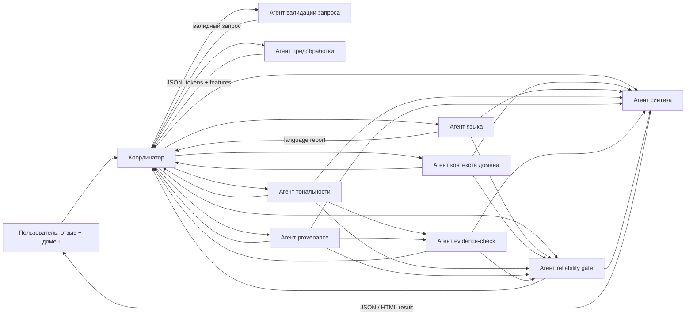

# Архитектура многоагентной системы анализа отзывов

## Назначение и границы

Система принимает отзыв и домен, отдельно оценивает тональность и provenance (человек / AI-generated), проверяет языковую поддержку и основания вывода, затем возвращает результат через CLI или локальную веб-форму. Текущая версия полностью запускается без сетевых API и ключей. Sentiment и provenance пока основаны на прозрачных эвристиках; обученный multitask Transformer и контролируемый корпус не предоставлены и не имитируются.

Задачи разделены, потому что у них разные метки, ошибки и метрики. Будущая multitask-модель будет иметь общую Transformer-основу и две task-specific головы. Многоагентная оболочка отвечает за валидацию, язык и домен, независимые оценки задач, контроль оснований, надёжность результата и представление. Такое разделение упрощает локализацию ошибок, но само по себе не доказывает преимущество над единой моделью. Это преимущество должно быть измерено предложенным экспериментом.

Provenance-классификация оценивает текстовые признаки и обученные метки в контролируемом наборе. Она не устанавливает личность автора и не должна использоваться как единственное доказательство авторства.

## Схема взаимодействия



Это фиксированный, ограниченный по шагам pipeline. Координатор только выбирает следующую роль, передаёт JSON-сообщение, сохраняет состояние и останавливает run по лимиту шага или времени. Предметные и текстовые операции выполняют специализированные агенты. Выходы тональности и provenance реально становятся входами evidence-agent; языковой, доменный и evidence-отчёты объединяются reliability-agent; synthesis получает эти отчёты и возвращает согласованный ответ.

## Роли и потоки

Система включает **девять специалистов и координатор**. Для всех девяти ролей определены отдельные критерии, сообщения и инструменты в [спецификации](agent-specification.md). Повторяющихся классификаторов нет: только sentiment-agent ставит метку тональности, только provenance-agent оценивает provenance.

Основная цепочка: `request_validation → preprocessing → language → (context, sentiment, provenance) → evidence → reliability → synthesis`. Три task/domain-роли запускаются по фиксированному сценарию; reliability ждёт все необходимые результаты.

## Состояние и надёжность

Каждый запуск хранит `RunState`: `run_id`, исходные поля запроса, счётчик и максимум шагов, отчёты агентов, события и монотонное время старта. Максимум — 12 шагов; текущий успешный сценарий использует 9 агентских шагов. Дедлайн — 15 секунд и проверяется перед каждым новым шагом. Это контролируемый дедлайн локального прототипа; он не может прервать уже исполняющуюся системную операцию посреди шага.

Каждый конверт `AgentMessage` проверяется на обязательные поля; агент проверяет наличие обязательных полей своего входного и выходного payload. Неизвестные payload-поля допускаются для версионируемого расширения. На ошибке агентского шага выполняется один ограниченный повтор; ошибки входа отклоняются валидатором с понятным сообщением. Все успешные и неуспешные вызовы агента/инструмента журналируются; при ошибке CLI и веб-форма сохраняют failure trace, если задан каталог.

Языковой агент поддерживает текущую английскую лексическую конфигурацию. Для русского, смешанного, пустого или неизвестного языка sentiment и provenance воздерживаются от оценки, а reliability gate возвращает `abstain`. Это лёгкий language heuristic для прототипа, не production language detector.

## Инструменты, данные и нагрузка

Два локальных ресурса: `data/domain_lexicons.json` (контекстные и полярные термины по доменам) и исполняемые Python-инструменты извлечения признаков/валидации/проверки evidence. Они не являются удалёнными API или научным корпусом. Секретов в коде нет.

В стандартном английском сценарии выполняются 9 вызовов специалистов и 8 локальных tool-вызовов; LLM-вызовов пока нет. Порог 40% считается только по фактическим LLM- и tool-вызовам, а вызовы агентов показываются отдельно. Сейчас восемь tool-вызовов распределены по одному между восемью специалистами, synthesis не вызывает tool; максимальная доля — 12,5%. Сводка автоматически считается из событий run и пишется в результат и JSONL trace.

## Запуск

```bash
python3.12 -m review_agents --text "The room was clean and comfortable." --domain hotel --log-dir runs
python3.12 -m review_agents --web --host 127.0.0.1 --port 8000 --log-dir runs
```

Локальная форма доступна на `http://127.0.0.1:8000`. Она по умолчанию слушает только localhost, экранирует пользовательский ввод, ограничивает размер формы и сохраняет trace. Подробные команды и версии Python описаны в README.

## Текущий статус относительно этапов

| Этап | Статус |
|---|---|
| **Ассайнмент 2 / неделя 5** | Тема, обоснование, схема, спецификации, 9 специалистов, CLI-прототип и взаимодействие реализованы. |
| **Ассайнмент 4 / неделя 10** | Оркестрация, web/CLI, bounded retry, дедлайн, логи, измерение нагрузки и восемь исполняемых тестов есть. Не завершены интеграция настоящей Transformer-модели и корпус. |
| **Экзамен** | Есть план сценариев и report/article drafts. Эмпирические результаты, финальный отчёт и презентация требуют запуска исследования на проверенном наборе. |

См. [сценарии и результаты проверки](scenarios.md), [спецификацию ролей](agent-specification.md), [отчёт](report.md) и [проект статьи](article-draft.md).
